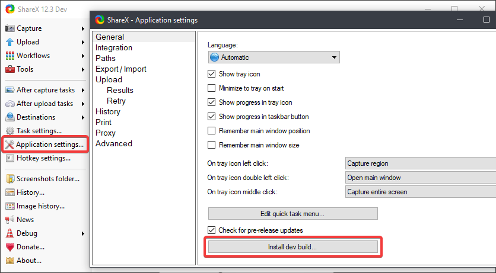

1. Open the "Application settings" window from the main window.

2. Click the "Install dev build" button to start the auto-update process.

If you don't already have ShareX installed, you can download the latest development build from the [ShareX DevBuilds releases page](https://github.com/ShareX/DevBuilds/releases/latest).

## macOS and Linux

ShareX for macOS and Linux is in preview on the cross-platform branch. Download the latest preview build for Apple silicon, Intel Macs or Linux from the [macOS and Linux artifacts page](/artifacts/).
